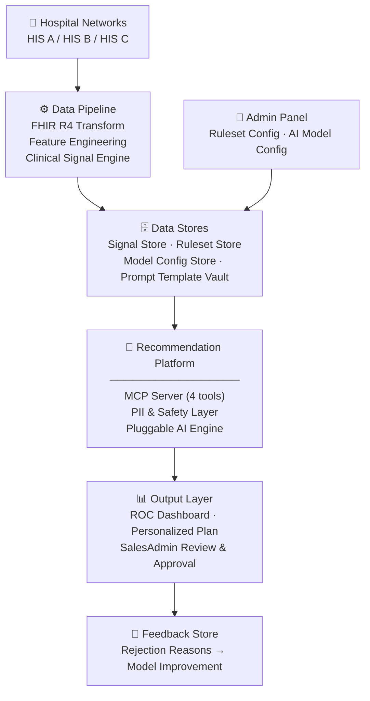

# AI Team Onboarding — Recommendation Engine

> **Last updated:** 2026-03-17 · **Version:** v3 · **Audience:** AI Engineering Team (POC)

---

## Table of Contents

1. [Introduction & Team Scope](#1-introduction--team-scope)
2. [Architecture Overview](#2-architecture-overview)
3. [The 12 Components — AI Team Scope](#3-the-12-components--ai-team-scope)
4. [Key Technical Decisions](#4-key-technical-decisions)
5. [Query-Time Data Flow](#5-query-time-data-flow)
6. [MCP Tools & Contracts](#6-mcp-tools--contracts)
7. [Output Schema — Two-Stage Assembly](#7-output-schema--two-stage-assembly)
8. [Tier & Add-On Logic](#8-tier--add-on-logic)
9. [Security & Compliance Requirements](#9-security--compliance-requirements)
10. [Performance SLAs](#10-performance-slas)
11. [Open Questions — Design Around These](#11-open-questions--design-around-these)
12. [Key Reference Documents](#12-key-reference-documents)

---

## 1. Introduction & Team Scope

### What This System Does

Navaveij is a **Smart Health Checkup Recommendation Dashboard** for a Thai private hospital network. It uses a hybrid rule-based + AI engine to recommend the right annual checkup package tier and individual add-on programs for each patient — based on their clinical history, biomarker trends, screening gaps, risk factors, and demographic constraints. The end result is a display-ready recommendation with explicit reasoning, a confidence score, and a ready-made communication script for the clinic's ROC staff to use with the patient.

### POC Evaluation Criteria

The POC is scored against four areas. Every architectural decision should be traceable to at least one of these:

| Criterion | Weight | What It Covers |
|-----------|--------|----------------|
| Hybrid Recommendation Engine + MCP Read-Only | **35%** | Rule-based + AI coordination, tool-call loop |
| Pluggable AI Architecture + Data Standards | **25%** | Model swapping, BAML, FHIR/LOINC/SNOMED |
| UX / Explainability (XAI) | **20%** | Reasoning trace, confidence score, trend display |
| Security, Privacy & Audit | **20%** | SMART on FHIR, PII masking, audit log |

### Team Scope Boundaries

**The AI team owns the Recommendation Platform** — the runtime inference layer that sits between pre-computed Data Stores and the Output Layer. Concretely, this is everything inside the _MCP Zone_, _PII & Safety_, and _Pluggable AI Engine_ zones.

| Team | Owns |
|------|------|
| **AI team (you)** | MCP Server, PII Masking, AI Gateway, Prompt Template Selector, Inference Orchestrator, AI Model, Output Schema Validator, Confidence Calibrator, Audit Logger, Safety Rule Validator, Graceful Degradation, PII Rehydration |
| **Data Platform team** | HIS integration, FHIR R4 transform, feature engineering, Clinical Signal Engine, Signal Store, Ruleset Store, Model Config Store, Prompt Template Vault |
| **Frontend team** | Dashboard UI (3 screens), screen routing, chart rendering, user interactions |

The AI team consumes pre-computed data from the Signal and Ruleset Stores (via MCP tools) and produces a fully validated `RecommendationOutput` JSON for the Frontend to render. The AI team does **not** write to those stores, and does **not** own any UI code.

---

## 2. Architecture Overview

### Very High Level (6 Blocks)



| Block | Description |
|-------|-------------|
| Hospital Networks | Source HIS systems (one or more hospitals) |
| Data Pipeline | Offline/batch: normalises raw HIS data to FHIR R4, runs feature engineering, applies clinical guidelines to produce pre-computed risk signals |
| Data Stores | Four pre-computed stores the AI team reads from (never writes to) |
| Admin Panel | Admin-configured inputs: ruleset policy, active AI model, safety rules |
| Recommendation Platform | **AI team scope** — all query-time inference logic |
| Output Layer | Frontend-rendered screens; SalesAdmin approval gate |
| Feedback Store | Rejection reasons fed back for model improvement |

### High Level — What the AI Team Builds

The Recommendation Platform contains three functional zones:

**Zone 1 — MCP Zone** (controlled read-only interface to Data Stores)
- MCP Server exposes 4 tools: `get_hard_constraints`, `get_clinical_signals`, `get_biomarker_trends`, `get_program_ruleset`
- All tools are read-only; no write paths are exposed

**Zone 2 — PII & Safety**
- Entry: SMART on FHIR Auth
- Wrap: PII Masking (intercepts MCP responses) and PII Rehydration (after AI output)
- Post-AI: Safety Rule Validator and Graceful Degradation fallback

**Zone 3 — Pluggable AI Engine**
- AI Gateway → Prompt Template Selector → Inference Orchestrator → AI Model → Output Schema Validator + Confidence Calibrator → Audit Logger

### Offline vs. Query-Time Separation

This is the most important architectural principle for the AI team:

| What | Where | When | Owner |
|------|-------|------|-------|
| FHIR transform, feature engineering, signal computation | Data Pipeline | Offline / batch | Data Platform |
| Ruleset config, model config, prompt templates | Data Stores | On-demand (admin) | Data Platform + Admin |
| All inference logic (steps 1–17 below) | Recommendation Platform | Query-time | **AI team** |

The AI team never processes raw FHIR or lab data directly. By the time data reaches the MCP tools, it is already pre-computed, normalised, and signal-ready.

---

## 3. The 12 Components — AI Team Scope

### Component Summary Table

| # | Component | Zone | Technology | TOR Criterion |
|---|-----------|------|-----------|---------------|
| 1 | SMART on FHIR Auth | PII & Safety | OAuth 2.0 (Keycloak) | §5.1 / Security 20% |
| 2 | MCP Server | MCP Zone | MCP server + read-only DB views | §4.2 / Hybrid 35% |
| 3 | PII Masking | PII & Safety | UUID v4 token mapping | §5.2 / Security 20% |
| 4 | AI Gateway | Pluggable AI Engine | Custom gateway + secret manager | §4.3 / Pluggable 25% |
| 5 | Prompt Template Selector | Pluggable AI Engine | Prompt Template Vault query | §4.3 / Pluggable 25% |
| 6 | Inference Orchestrator | Pluggable AI Engine | ReAct loop (LangGraph-style) | §4.2 / Hybrid 35% |
| 7 | AI Model | Pluggable AI Engine | GPT-4o / Claude 3.5 Sonnet / Local Llama | §3.2 / Hybrid 35% + XAI 20% |
| 8 | Output Schema Validator + Confidence Calibrator | Pluggable AI Engine | BAML validator + scoring function | §3.3 / XAI 20% |
| 9 | Audit Logger | Pluggable AI Engine | Append-only log store | §5.3 / Security 20% |
| 10 | Safety Rule Validator | PII & Safety | Rule evaluation engine | §6.2 / Hybrid 35% + Security 20% |
| 11 | Graceful Degradation | PII & Safety | Re-query Signal/Ruleset Store | §6.2 |
| 12 | PII Rehydration | PII & Safety | In-memory token substitution | §5.2 / Security 20% |

### Component Details

**1. SMART on FHIR Auth**
- Validates every inbound recommendation request against an OAuth 2.0 access token and FHIR resource-level scope
- Returns HTTP 401 on denial; all downstream components are unreachable without a valid grant
- Scope must cover at minimum: `patient/*.read`, `observation.read`, `condition.read`

**2. MCP Server**
- Exposes 4 read-only tools to the Inference Orchestrator (see §6 for full tool specs)
- Enforces Least Privilege: no write paths, no cross-patient queries, no bulk exports
- Each tool call is scoped to a single `patient_token`

**3. PII Masking**
- Intercepts every MCP tool response before it is assembled into the AI context
- Replaces PII fields (patient name, date of birth, HN, exact dates where re-identifiable) with stable UUID v4 tokens
- Builds an in-memory rehydration map (`token → real_value`) scoped to the current request
- The map is **never persisted, never logged, never serialised to disk**

**4. AI Gateway**
- Reads `AI_ACTIVE_CLIENT` from the Model Config Store (admin-configurable)
- Routes the inference request to the correct model endpoint with the correct API key from secret manager
- A model swap is a config change only — no code deployment required

**5. Prompt Template Selector**
- Loads the version-tagged system prompt for the currently active model
- Templates are model-specific (different instruction styles for GPT-4o vs. Claude vs. Llama)
- Template version is recorded in `metadata.template_version` on every output for auditability

**6. Inference Orchestrator**
- Manages the two-phase ReAct loop:
  - **Phase 1 (fixed baseline):** Executes all 4 MCP calls unconditionally, assembles initial masked context
  - **Phase 2 (AI-driven):** Sends context + prompt to AI Model; AI may issue additional MCP tool calls; each response is masked before re-entering context
- Hard cap on Phase 2 iterations (prevents runaway loops); on cap hit, AI commits output from current context
- Orchestrator tracks the full tool-call trace for audit

**7. AI Model**
- Receives masked patient context + version-tagged system prompt
- Reasons over the context and emits a **BAML-structured Stage 1 output** (see §7)
- Model selection is transparent to the Orchestrator — it calls the Gateway, not the model directly
- The AI does **not** compute confidence scores; it does **not** apply safety rules; it **does not** have access to un-masked PII

**8. Output Schema Validator + Confidence Calibrator**
- **Validator:** Enforces BAML schema on the raw AI output (validation rules V1–V10); rejects malformed output and triggers Graceful Degradation
- **Calibrator:** Computes the system-side confidence score immediately after successful validation:

  ```
  confidence_score = (0.4 × signal_coverage)
                   + (0.4 × data_completeness)
                   + (0.2 × rule_agreement)

  signal_coverage    = signals_with_data / total_expected_signals
  data_completeness  = required_fields_present / total_required_fields
  rule_agreement     = 1.0 if ai_tier == rule_tier, else 0.0

  High   ≥ 0.75
  Medium ≥ 0.50
  Low    < 0.50
  ```

**9. Audit Logger**
- Writes **synchronously** — the response is not returned until the log entry is committed
- Every entry is SHA-256 hash-chained to the previous entry (immutability guarantee)
- 5-dimension log record:

  | Dimension | Fields |
  |-----------|--------|
  | **Who** | `user_id`, `user_role` |
  | **When** | ISO 8601 timestamp |
  | **Where** | `service_id`, `client_ip` |
  | **What** | `prompt`, `masked_context`, `masked_response`, `model_id`, `latency_ms` |
  | **Why** | `request_context` (patient_token, action_type, request_id) |

- The audit log never contains un-masked PII — the rehydration map is discarded before the log write

**10. Safety Rule Validator**
- Runs **after** the Output Schema Validator and **before** PII Rehydration
- Checks every add-on item and the recommended tier against hard constraints:
  - Gender eligibility (e.g., mammogram → female only)
  - Age eligibility (e.g., PSA → male 50+)
  - Tier ceiling rules (configured by admin)
  - Any admin-configured safety overrides
- On violation: silently removes the offending item from `add_ons[]`; logs a conflict event to the audit log
- Violations are **not** surfaced in the UI response — they are transparent at the audit log level only

**11. Graceful Degradation**
- Triggered when: AI model is unavailable, BAML validation fails after retry, or Phase 2 iteration cap is hit without valid output
- Falls back to a rule-only recommendation built directly from `get_program_ruleset` output
- Sets `recommendation_source = "RuleBased"` and `review_required = true` in the Stage 2 output
- Ensures the system always returns a usable recommendation even when AI fails

**12. PII Rehydration**
- Reads the in-memory token map built by PII Masking (step 3)
- Substitutes UUID tokens back to real patient identifiers in the final output
- Map is immediately discarded from memory after substitution
- The display-ready output contains real identifiers; the audit log does not

---

## 4. Key Technical Decisions

### Decision 1 — Hybrid Engine Coordination

**Decision:** The system runs two rule evaluations and one AI inference in the following order:
1. Hard Constraints (non-overridable; applied by Safety Rule Validator)
2. Rule Preliminary Tier (computed by Ruleset engine from `get_program_ruleset`)
3. AI Recommended Tier (AI can deviate from the rule tier, but must provide `tier_deviation_justification`)

**Rationale:** Hard constraints ensure patient safety and eligibility are never violated even if the AI hallucinates. The rule preliminary tier gives the AI a grounded starting point. AI deviation is allowed but must be explicit and auditable.

**Implementation implication:** Both `rule_preliminary_tier` and `ai_recommended_tier` must be present in every output — never merge them silently. If they disagree, `tier_deviation_justification` is mandatory (enforced by validator rule V5).

---

### Decision 2 — MCP ReAct Tool-Call Loop

**Decision:** A two-phase ReAct loop. Phase 1 executes 4 fixed MCP calls unconditionally. Phase 2 lets the AI issue additional tool calls as needed.

**Rationale:** The 4 baseline calls cover the minimum clinical context required for any recommendation. Phase 2 allows the AI to request additional detail (e.g., deeper trend data) when relevant — without making every call mandatory overhead.

**Implementation implication:** Phase 2 must have a hard iteration cap to prevent runaway loops. All tool calls must go through the MCP Server (no direct DB queries). Every Phase 2 MCP response must be masked before being added to the AI context.

---

### Decision 3 — PII Masking Strategy

**Decision:** Replace PII fields with UUID v4 tokens before any data enters the AI context. The token map lives only in request-scoped memory.

**Rationale:** External AI models (GPT-4o, Claude) are third-party services. Sending patient PII to a third party without pseudonymization would violate PDPA and HIPAA. The stable UUID tokens allow the AI to reason about the patient (e.g., cross-referencing signals) without seeing real identifiers.

**Implementation implication:** The masking layer must intercept MCP responses at a single well-defined point in the pipeline — not ad-hoc per field. The token map must never be serialised, logged, or passed beyond the current request boundary. PII Rehydration must run after the Audit Logger (so the log never contains real PII).

---

### Decision 4 — Pluggable AI via Gateway + Config

**Decision:** A single active model per environment, selected via admin-configurable `AI_ACTIVE_CLIENT` in the Model Config Store. Model swap = config change only (no code deployment).

**Rationale:** The POC must demonstrate switchability between GPT-4o, Claude 3.5 Sonnet, and Local Llama. Hardcoding model selection in code would require a deploy for every switch — unacceptable for a live demo.

**Implementation implication:** The Inference Orchestrator never calls a model directly — it always calls the AI Gateway. BAML defines 4 clients (`GPT4o`, `Claude35Sonnet`, `Claude3Opus`, `LocalLlama`) plus an `ActiveModel` fallback alias. The active model is resolved at runtime by the Gateway.

---

### Decision 5 — Confidence Score is System-Computed

**Decision:** The confidence score is computed by the Confidence Calibrator (system code), not by the AI model.

**Rationale:** AI self-reported confidence scores are poorly calibrated — models frequently express high confidence for incorrect outputs, and low confidence for correct ones. A deterministic formula based on measurable inputs (signal coverage, data completeness, rule agreement) is more reliable and auditable.

**Implementation implication:** The AI output schema (BAML) contains **no** confidence field. The Calibrator computes it after BAML validation and injects it as a Stage 2 field. The formula is:

```
confidence_score = (0.4 × signal_coverage) + (0.4 × data_completeness) + (0.2 × rule_agreement)
```

---

### Decision 6 — Safety Rule Validator Runs Post-AI

**Decision:** Safety validation is a post-processing step, not a pre-filtering step. The AI sees the full candidate add-on list; invalid items are silently removed after AI output.

**Rationale:** Pre-filtering would hide clinical context from the AI (e.g., the AI might not know why certain items are absent). Letting the AI reason over the full candidate list and then applying post-AI safety rules gives the AI better context while still guaranteeing compliance.

**Implementation implication:** Violations are never surfaced in the API response. The AI team must ensure the audit log captures every removal event. The UI team must not expose the removed items; they simply won't appear in `add_ons[]`.

---

### Decision 7 — Audit Logger is Synchronous

**Decision:** The Audit Logger writes its entry before the response is returned to the caller.

**Rationale:** PDPA compliance requires that every access to patient data be logged. An async log introduces a window where the response is sent but the log is not yet committed — creating an audit gap.

**Implementation implication:** The audit write is on the critical path. Keep it fast (append-only store). The SHA-256 hash chain requires sequential writes (no concurrent log entries for the same session). Measure audit write latency as part of overall SLA tracking.

---

## 5. Query-Time Data Flow

The following 17 steps describe a single recommendation request from entry to response. This is the authoritative flow the AI team implements.

```
[Request in]
     │
     ▼
 1. ROC Staff submits recommendation request (patient_token + SMART scope)
     │
     ▼
 2. SMART on FHIR Auth validates token and scope
     │  → 401 Unauthorized if denied
     │
     ▼
 3. Inference Orchestrator — Phase 1 (fixed baseline)
     │  Executes 4 MCP calls in sequence:
     │    get_hard_constraints(patient_token)
     │    get_clinical_signals(patient_token)
     │    get_biomarker_trends(patient_token)
     │    get_program_ruleset(tier, gender, age)
     │
     ▼
 4. PII Masking intercepts all 4 MCP responses
     │  Replaces PII fields with UUID v4 tokens
     │  Builds in-memory rehydration map
     │
     ▼
 5. Orchestrator assembles initial masked context
     │  (hard constraints + signals + trends + ruleset in a single context object)
     │
     ▼
 6. AI Gateway reads AI_ACTIVE_CLIENT from Model Config Store
     │  Resolves to: GPT-4o | Claude 3.5 Sonnet | Local Llama
     │
     ▼
 7. Prompt Template Selector loads version-tagged template for active model
     │
     ▼
 8. Inference Orchestrator — Phase 2 (AI-driven)
     │  Sends assembled prompt + masked context to AI Model via AI Gateway
     │
     ▼
 9. AI Model may issue additional MCP tool calls
     │  Each additional response → masked → added to context
     │  Hard iteration cap enforced
     │
     ▼
10. AI Model emits BAML-structured Stage 1 output
     │
     ▼
11. Output Schema Validator enforces BAML schema (rules V1–V10)
     │  → On failure: trigger Graceful Degradation (→ step 11a)
     │
     ▼
12. Confidence Calibrator computes confidence_score + confidence_tier
     │  Formula: (0.4 × signal_coverage) + (0.4 × data_completeness) + (0.2 × rule_agreement)
     │
     ▼
13. Audit Logger writes synchronous entry (masked context only)
     │  SHA-256 hash chain appended
     │
     ▼
14. Safety Rule Validator re-checks all add-on items and tier
     │  Silently removes any ineligible items
     │  Logs conflict events to audit log
     │
     ▼
15. PII Rehydration re-attaches real identifiers
     │  Token map discarded from memory
     │
     ▼
16. Display-ready RecommendationOutput delivered to Output Layer
     │  (ROC Dashboard + Personalized Plan + SalesAdmin Review)
     │
     ▼
17. SalesAdmin approves or rejects
     └→ Rejection reason stored in Feedback Store

[11a — Graceful Degradation path]
     │  AI unavailable or BAML validation fails
     │  Re-query Signal/Ruleset Store directly
     │  Build rule-only recommendation
     │  Set: recommendation_source = "RuleBased", review_required = true
     └→ Rejoin at step 12
```

---

## 6. MCP Tools & Contracts

The MCP Server exposes 5 tools. 4 are called by the Inference Orchestrator during AI inference; 1 is called by the Frontend directly (not part of the AI inference pipeline).

### Tool Table

| # | Tool | Caller | Returns | Non-Overridable? |
|---|------|--------|---------|------------------|
| 1 | `get_hard_constraints(patient_token)` | Inference Orchestrator | Gender/age exclusions, safety flags | Yes |
| 2 | `get_clinical_signals(patient_token)` | Inference Orchestrator | Risk flags, screening gaps, vaccination gaps, abnormal triggers | No |
| 3 | `get_biomarker_trends(patient_token)` | Inference Orchestrator | Lab history, trend direction, velocity, eGFR slope | No |
| 4 | `get_program_ruleset(tier, gender, age)` | Inference Orchestrator | Package resolution map, tier rules, add-on items library | No |
| 5 | `get_patient_event_timeline(patient_token)` | Dashboard UI (Frontend) | Clinical event history (5 arrays) | N/A |

### Key Schema Notes

**Tool 1 — `get_hard_constraints`**

Returns non-overridable eligibility rules applied before and after AI inference. Key fields:
- `eligible_tiers[]` — list of tiers the patient qualifies for
- `gender_restrictions{}` — map of item_id → ["male"/"female"]
- `age_restrictions{}` — map of item_id → `{min_age, max_age}`
- `safety_flags[]` — absolute exclusions (e.g., contrast CT for CKD stage 4+)

**Tool 2 — `get_clinical_signals`**

Returns pre-computed risk signals organised into four sub-objects:
- `risk_flags[]` — named signals with severity (e.g., `hypertension_stage_2`, `high_ldl`)
- `screening_gaps[]` — overdue screenings with `days_overdue` and `next_recommended_date`
- `vaccination_gaps[]` — overdue vaccines
- `abnormal_triggers[]` — follow-up triggers from previously abnormal results

Each signal has a `signal_id` (snake_case, traceable to clinical guidelines) and a `severity` (`high`/`moderate`/`low`).

**Tool 3 — `get_biomarker_trends`**

Returns time-series lab data for 6 core biomarkers plus any additional relevant labs:
- Per biomarker: `loinc_code`, `unit`, `values[]` (date + value pairs), `trend_direction` (`rising`/`stable`/`falling`), `slope` (change/year), `reference_range`
- Core biomarkers: FBS (1558-6), HbA1c (4548-4), LDL (13457-7), BMI (39156-5), BP Systolic (8480-6), eGFR (62238-1)

**Tool 4 — `get_program_ruleset`**

Returns admin-configurable program logic:
- `tier_rules[]` — 4 rules (PREMIUM_SEVERE_SINGLE, PREMIUM_MULTI_SIGNAL, ADVANCED_METABOLIC_OR_CVD, STANDARD_DEFAULT) with signal conditions
- `resolved_package` — the Navavej product matching the computed tier for this patient's gender/age
- `add_on_items[]` — full library of 28+ individually recommendable items with `item_id`, `label`, `triggers[]`, `product_code`, `price_thb`, `category`, `priority`

**Tool 5 — `get_patient_event_timeline`** _(UI-facing, not part of AI inference)_

Returns 5 arrays of clinical history events for the Trend & Timeline screen:
- `diagnoses[]`, `hospitalizations[]`, `significant_lab_events[]`, `screening_procedure_history[]`, `medication_changes[]`
- Each event: `event_type`, `date`, `description`, `icd10_code`/`loinc_code` where applicable
- `timeline_span{}` — `earliest_event_date`, `latest_event_date`, `years_covered`

### Important Constraints on All Tools

- All tools are **read-only** — no write or update operations are exposed
- All calls are scoped to a **single `patient_token`** — no bulk or cross-patient queries
- All tool responses are **pre-computed** — the MCP Server reads from Signal/Ruleset Stores, not live HIS data
- All tool responses must pass through **PII Masking** before entering the AI context

---

## 7. Output Schema — Two-Stage Assembly

The final `RecommendationOutput` is assembled in two stages. This distinction is critical — it defines what the AI model is responsible for vs. what the system computes.

### Stage 1 — AI-Generated (BAML Scope)

The AI model must produce all fields in this stage. These are defined in `recommendation-output.baml` and enforced by the Output Schema Validator.

```
RecommendationOutput (Stage 1)
├── ai_recommended_tier        Tier enum: "Standard" | "Advanced" | "Premium"
├── tier_deviation_justification  string? (required if ai_tier ≠ rule_tier — see V5)
├── add_ons[]
│   ├── item_id                string (must match an item_id in get_program_ruleset response)
│   ├── label                  string
│   ├── rationale              string (patient-specific explanation)
│   ├── priority               "Red" | "Orange" | "Yellow" | "Green"
│   ├── product_code           string
│   ├── price_thb              float | null (null = "Price TBD")
│   └── category               AddOnCategory enum
├── reasoning_trace            string (chain-of-thought — displayed as XAI)
├── supporting_signals[]       string[] (signal_ids that drove the recommendation)
├── missing_signals[]          string[] (data gaps that limited confidence)
└── communication_script
    ├── health_summary         string
    ├── recommendation_rationale  string
    ├── addon_highlights       string
    └── next_steps             string
```

**BAML clients defined:**

| Client ID | Model | Use Case |
|-----------|-------|----------|
| `GPT4o` | gpt-4o | Default cloud model |
| `Claude35Sonnet` | claude-3-5-sonnet-20241022 | Alternative cloud model |
| `Claude3Opus` | claude-3-opus-20240229 | High-reasoning tasks |
| `LocalLlama` | llama3.1:70b (Ollama) | Air-gapped / on-premise |
| `ActiveModel` | ← resolves to whichever is configured | Runtime selection |

### Stage 2 — System-Injected (Post-AI)

These fields are computed by the system after AI output is validated. The AI never produces these.

```
RecommendationOutput (Stage 2 additions)
├── rule_preliminary_tier      Tier (from get_program_ruleset tier rules)
├── resolved_package
│   ├── product_code           string
│   ├── name                   string
│   └── price_thb              float | null
├── confidence_score           float (0.0–1.0, system-computed)
├── confidence_tier            "High" | "Medium" | "Low"
├── review_required            bool (true on graceful degradation)
├── recommendation_source      "AI" | "RuleBased"
├── patient_high_alert
│   ├── critical_signals[]     CriticalSignalAlert[] (signal_id, display_label, severity)
│   └── missing_data_alerts[]  MissingDataAlert[] (field_name, impact_description)
└── metadata
    ├── request_id             UUID
    ├── model_id               string (e.g., "claude-3-5-sonnet-20241022")
    ├── template_version       string (e.g., "v3.2")
    └── latency_ms             int
```

### Validation Rules (V1–V10)

The Output Schema Validator enforces all of the following. A violation triggers Graceful Degradation.

| Rule | Check |
|------|-------|
| V1 | `ai_recommended_tier` must be one of ["Standard", "Advanced", "Premium"] |
| V2 | Every item in `add_ons[]` must have an `item_id` present in the ruleset response |
| V3 | Every item in `add_ons[]` must have a non-empty `rationale` |
| V4 | Every item in `add_ons[]` must have a valid `priority` value |
| V5 | If `ai_recommended_tier` ≠ `rule_preliminary_tier`, `tier_deviation_justification` must be non-empty |
| V6 | `reasoning_trace` must be non-empty |
| V7 | `supporting_signals[]` must reference valid signal IDs from the clinical signals response |
| V8 | `communication_script` must have all 4 sections non-empty |
| V9 | `add_ons[]` must not be empty unless no clinical triggers are present |
| V10 | `price_thb` on each add-on must match the value in the ruleset OR be null (no AI-invented prices) |

---

## 8. Tier & Add-On Logic

### Tier Selection Rules (Admin-Configurable)

The Ruleset Store applies these 4 rules in priority order to compute `rule_preliminary_tier`:

| Rule ID | Condition | Resulting Tier |
|---------|-----------|----------------|
| `PREMIUM_SEVERE_SINGLE` | Any single signal with severity = "high" | Premium |
| `PREMIUM_MULTI_SIGNAL` | ≥ 3 signals with severity = "moderate" | Premium |
| `ADVANCED_METABOLIC_OR_CVD` | Any metabolic or cardiovascular signal present | Advanced |
| `STANDARD_DEFAULT` | None of the above | Standard |

Rules are evaluated top-down; the first match wins.

### Priority Levels

Add-on items are assigned one of four priority levels:

| Level | Colour | Clinical Meaning |
|-------|--------|-----------------|
| Red | 🔴 | Immediate follow-up required; significant safety concern |
| Orange | 🟠 | High clinical urgency; action within weeks |
| Yellow | 🟡 | Moderate risk; schedule within the visit cycle |
| Green | 🟢 | Routine / preventive; opportunistic add-on |

The UI sorts add-ons Red → Orange → Yellow → Green. The AI assigns the priority level; the Safety Rule Validator can remove items but does not re-assign priority.

### Add-On Library Summary

28+ individually recommendable items across 10 categories:

| Category | Example Items |
|----------|---------------|
| Cardiac | Exercise Stress Test (EST), Echocardiogram (ECHO), CT-CAC, Cardiac Patch Monitor, Carotid Ultrasound |
| GI / Liver | Endoscopy Package, FibroTouch, Hepatitis A/B/C Screening, GI/Liver Screen Package |
| Cancer Screening | Mammogram, Pap Smear + HPV DNA, Prostate & Bladder Ultrasound, SPOT-MAS Multi-Cancer, Low-Dose CT Lung |
| Endocrine | Diabetes Screen Pro, Menopause Screening, Male Hormone Assessment, Thyroid Pro 1 & 2 |
| Women's Health | Cervical Cancer + HPV Screening, Menopause Screening Pro Premium, Pre-marriage Check |
| Bone & Joint | Osteoporosis DEXA, Spine MRI, PRP Joint Injection |
| Brain / Neuro | Full Sleep Test (PSG), Sleep Apnea + CPAP Trial, Dementia Screening, Chronic Headache Assessment |
| Kidney | Kidney Disease Screening |
| Allergy & Skin | Food Allergy Test, Airborne Allergy Test, Combined Allergy Panel |
| Vaccine | Influenza, Senior Flu, Dengue, HPV, Pneumococcal, Hepatitis B |

**Handling `price_thb: null`:** Five items have unresolved prices (see §11 OQs). The system must render `null` prices as "Price TBD" in any price-facing output. Do not substitute 0 or any other placeholder number.

---

## 9. Security & Compliance Requirements

### SMART on FHIR (TOR §5.1)

- Every request must carry a valid OAuth 2.0 token with FHIR resource-level scope
- Scope enforcement is at the entry point (SMART on FHIR Auth) — not replicated in downstream components
- Failed auth returns HTTP 401 with no clinical data in the response body

### PII Masking (TOR §5.2)

- PII masking is mandatory for **all** data that reaches the AI model — no exceptions
- UUID v4 tokens are stable within a single request (AI can cross-reference signals) but differ across requests
- The in-memory token map must be garbage-collected at the end of every request, regardless of success or failure

### Audit Logging (TOR §5.3 / PDPA §40)

- All 5 dimensions (Who / When / Where / What / Why) are required on every log entry
- The Audit Logger must write **synchronously** before the response is returned
- SHA-256 hash chain: each entry's hash includes the hash of the previous entry — breaking the chain is detectable
- Minimum retention: **3 years** (PDPA §40); configurable by admin
- The log must contain masked context only — real PII must never appear in any log entry
- Log entries must include: `prompt`, `masked_context`, `masked_response`, `model_id`, `template_version`, `latency_ms`

### RBAC (TOR §3.4)

Five predefined roles with Least Privilege:

| Role | Permissions |
|------|------------|
| `physician` | View patient records, view recommendations, request recommendations |
| `nurse` | View patient records, view recommendations |
| `pharmacist` | View medication records only |
| `admin` | Manage ruleset config, manage AI model config, view audit logs, manage users |
| `dpo` | View all audit logs, run anomaly reports, view RBAC settings (read-only) |

### Data Masking Before External AI

- When using cloud AI models (GPT-4o, Claude), PII masking is a hard requirement
- When using Local Llama (on-premise), masking is still required for consistency and auditability
- The masking implementation must be model-agnostic (same pipeline for all AI clients)

---

## 10. Performance SLAs

The system must meet the following end-to-end latency targets (from request submission to display-ready response):

| Patient Type | Data Retrieval (MCP Phase 1) | AI Processing (Phase 2 + post-processing) | Total |
|---|---|---|---|
| New customers (first visit) | < 3 sec | < 7 sec | **≤ 10 sec** |
| Existing customers (returning) | < 10 sec | < 20 sec | **≤ 30 sec** |

Existing customers have richer data (more lab history, more signals), which justifies the longer budget.

**Latency tracking:** `latency_ms` in `metadata` must capture AI processing time only (steps 8–15). Total request latency should be measured at the API boundary and surfaced in the access monitoring dashboard.

**Medical Acceptance Test (MAT):** >95% accuracy requirement — defined as ≥ 3 out of 5 medical experts agreeing with the recommendation. This is a validation gate, not a runtime metric, but the AI team must ensure the reasoning_trace is detailed enough to enable expert review.

---

## 11. Open Questions — Design Around These

These questions are unresolved as of 2026-03-17. The AI team must design defensively — do not hardcode values for any of these items.

| ID | Question | Implementation Guidance |
|----|----------|-------------------------|
| OQ-7 | Is colonoscopy a standalone program or always bundled with upper GI endoscopy? | Use placeholder `product_code: "colonoscopy_tbc"`; do not hardcode price or bundle logic |
| OQ-10 | PSA test — product code and price? | Set `price_thb: null`; display "Price TBD" in output |
| OQ-HepB | Hepatitis B vaccine per-dose price? | Set `price_thb: null` |
| OQ-Pneumo | Is it PCV20 or PCV15+PPSV23? | Hold on vaccine rule logic; flag as pending in add-on item definition |
| OQ-Shingrix | Shingrix per-dose price? | Set `price_thb: null` |
| OQ-Prices | All current prices are 5th Anniversary Expo 2026 promotional (expire 2026-03-31) | Price data must be externally configurable (not hardcoded); the system must support price updates without a code deploy |
| OQ-HIS | Which HIS system(s) are in use, and what is their FHIR R4 readiness? | MCP tool contracts are finalised; upstream data source is TBD — design MCP tools to be agnostic to source |
| OQ-PackageItems | What items are included in Gold, Platinum Male/Female, and Diamond tiers? | Deduplication logic (package item vs. add-on item) cannot be finalised — implement a configurable dedup list |
| OQ-WeightLoss | Is there a composite weight-loss workup product? | Set `price_thb: null`; treat as a single item with `item_id: "weight_loss_workup"` |

---

## 12. Key Reference Documents

Use these documents for deeper detail on specific areas. Do not treat this onboarding document as a substitute for the contracts — always refer to the contracts when implementing.

The base path for all v3 documents is:
`doc_outputs/architecture/AI/Recommendation Engine/v3/`

| Document | Relative Path | Go Here When |
|----------|--------------|--------------|
| Architecture — very high level | `very-high-level.md` | Presenting to non-technical stakeholders |
| Architecture — high level | `high-level.md` | Understanding full component wiring and zone boundaries |
| Component Inventory + Solution Approaches | `component-inventory-solution-approach.md` | Implementing any of the 12 components; 17-step flow detail |
| Signal Store Contract | `schema-contracts/signal-store-contract.md` | Implementing MCP tools 1, 2, 3 |
| Ruleset Store Contract | `schema-contracts/ruleset-store-contract.md` | Implementing MCP tool 4 |
| Recommendation Output Schema | `schema-contracts/recommendation-output-schema.md` | Stage 1 + Stage 2 full field spec; validation rules V1–V10 |
| BAML Schema | `schema-contracts/recommendation-output.baml` | AI structured output definition; client configuration |
| Event Timeline Contract | `schema-contracts/event-timeline-contract.md` | MCP tool 5 (Frontend-facing) |
| Access Monitoring Contract | `schema-contracts/access-monitoring-contract.md` | Audit log schema, RBAC model, anomaly detection schema |
| Clinical Guidelines Reference | `data/clinical-guidelines-reference.md` | Understanding signal thresholds (lab ranges, BP classification, cancer screening intervals, etc.) |
| FHIR Discovery Report | `data/fhir-discovery-report.md` | Understanding upstream FHIR R4 resource structure and LOINC codes |
| Rule Synthesis Framework | `samples/rule-synthesis-framework.md` | Understanding how clinical guidelines were translated into ruleset rules |
| Sample Tier Ruleset (JSON) | `samples/sample_ruleset_tier_config.json` | Machine-readable tier selection rules |
| Sample Add-On Items (JSON) | `samples/sample_add_on_items.json` | Machine-readable add-on item library (28+ items with prices) |
| Sample Patient (JSON) | `samples/sample_patient_checkup.json` | Reference patient — Somchai W., 54yo male — for end-to-end testing |
| Checkpoint + Progress Tracker | `__checkpoint.md` | Overall progress, OQ status, next steps |
| Terms of Reference (TOR) | `doc_inputs/ENG_TOR - Smart Health Checkup Recommendation Dashboard v7_Final.md` | Full functional requirements, SLA definitions, security standards |
| POC Evaluation Criteria | `doc_inputs/ENG_POC_ Smart Health Checkup Recommendation Dashboard_FINAL.md` | Scoring weights and POC presentation requirements |

---

*For questions about this document, contact the project lead. For open questions (§11), escalate to the client — do not unilaterally resolve them.*
